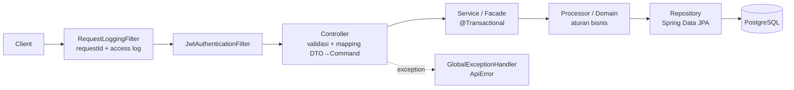
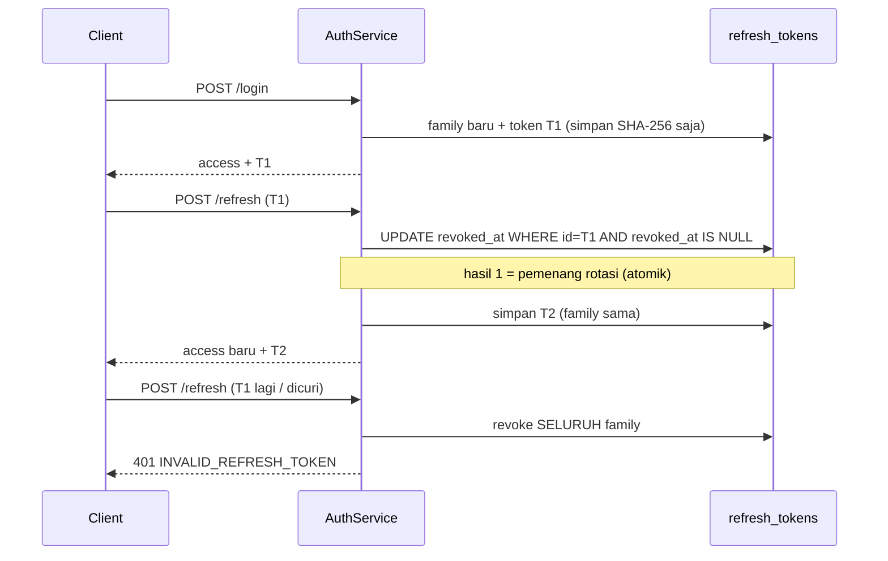
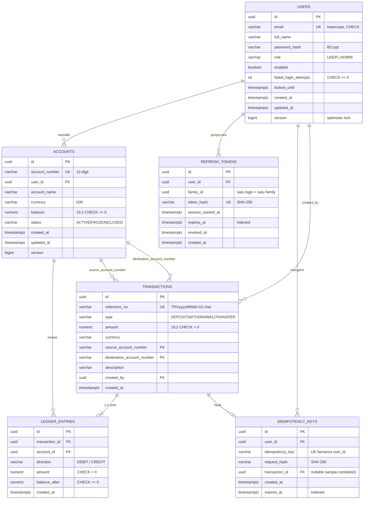
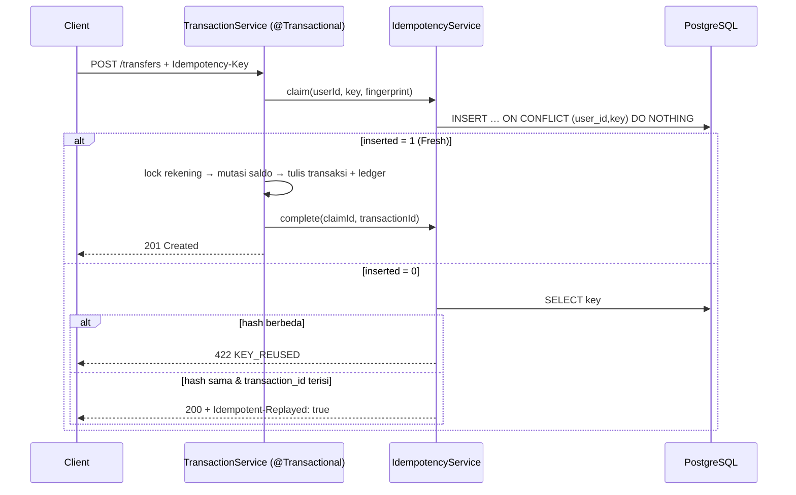

# 🏦 Digital Banking API

REST API perbankan digital sederhana yang dibangun dengan **Java 25 + Spring Boot 4.1 + PostgreSQL**.
Fokus project ini bukan banyaknya fitur, tetapi **kebenaran uang**: setiap perpindahan saldo harus
atomik, tidak bisa terjadi dua kali (idempotent), tidak bisa membuat saldo negatif, dan seluruh
jejaknya tercatat permanen (ledger append-only).

> Dokumen ini ditulis agar penilai dapat memetakan setiap kriteria penilaian ke **kode yang konkret**.
> Lihat bagian [Pemetaan Kriteria Penilaian](#-pemetaan-kriteria-penilaian) untuk ringkasannya.

---

## 📑 Daftar Isi

1. [Pemetaan Kriteria Penilaian](#-pemetaan-kriteria-penilaian)
2. [PRD (Product Requirements Document)](#-prd-product-requirements-document)
3. [Tech Stack](#-tech-stack)
4. [Arsitektur & Struktur Folder](#-arsitektur--struktur-folder)
5. [Struktur API & Design Pattern](#-1-struktur-api--design-pattern)
6. [Authentication](#-2-authentication-implementation)
7. [Database Design & ERD](#-3-database-design--erd)
8. [Query Efficiency](#-4-query-efficiency)
9. [Error Handling](#-5-error-handling)
10. [Security Basic Practice](#-6-security-basic-practice)
11. [Code Readability & Maintainability](#-7-code-readability--maintainability)
12. [Idempotency](#-8-idempotency-implementation)
13. [Database Transaction Integrity](#-9-database-transaction-integrity)
14. [Structured Logging](#-10-structured-logging)
15. [Unit Test & Mocking](#-11-unit-test--mocking)
16. [Cara Menjalankan](#-cara-menjalankan)
17. [Referensi Endpoint](#-referensi-endpoint)
18. [Batasan Diketahui & Roadmap](#-batasan-yang-diketahui--roadmap)

---

## ✅ Pemetaan Kriteria Penilaian

| # | Kriteria | Implementasi singkat | Lokasi utama |
|---|----------|----------------------|--------------|
| 1 | Struktur API (+ design pattern) | Package-by-feature, layering Controller → Service → Repository, **Strategy**, **Factory/Registry**, **Facade**, **Command**, **Rich Domain Model**, **Sealed type** | `transaction/`, `transaction/processor/` |
| 2 | Authentication | JWT access token 15 menit (HS256) + **refresh token rotation** + reuse detection + lockout login + logout / logout-all | `auth/`, `security/` |
| 3 | Database design | 5 tabel ternormalisasi, UUIDv7, `NUMERIC(19,2)`, CHECK constraint, FK, UNIQUE, trigger append-only, migrasi Flyway | `db/migration/` |
| 4 | Query efficiency | Index komposit untuk statement, DTO projection (tanpa N+1), paginasi ter-clamp, `open-in-view: false`, bulk update atomik | `LedgerEntryRepository`, `V1__init_schema.sql` |
| 5 | Error handling | `BusinessException` + `ErrorCode` enum, `@RestControllerAdvice`, format error tunggal `ApiError`, detail internal tidak bocor | `common/exception/` |
| 6 | Security basic practice | BCrypt cost 12, anti user-enumeration (timing), security headers, CORS whitelist, cookie HttpOnly/Secure/SameSite, validasi input, IDOR-safe | `config/SecurityConfig`, `AuthService` |
| 7 | Readability & maintainability | Package-by-feature, `record` DTO, config type-safe (`@ConfigurationProperties`), Javadoc "kenapa", method kecil | seluruh project |
| 8 | Idempotency | Header `Idempotency-Key`, klaim atomik `INSERT … ON CONFLICT DO NOTHING`, request-hash, replay `200` + header | `idempotency/` |
| 9 | DB transaction integrity | **Satu** `@Transactional` membungkus klaim → lock → mutasi saldo → ledger → completion; `SELECT … FOR UPDATE` berurutan (anti-deadlock) | `TransactionService`, `AccountLockService` |
| 10 | Structured logging | JSON/ECS bawaan Spring Boot, MDC `requestId` + `userId`, key-value log, access log per request | `logging/RequestLoggingFilter` |
| 11 | Unit test – mocking | `@WebMvcTest` + `@MockitoBean` untuk controller (17 skenario). Lihat [catatan jujur](#-11-unit-test--mocking) tentang cakupan | `src/test/` |

---

## 📋 PRD (Product Requirements Document)

### 1. Latar Belakang & Tujuan

Nasabah membutuhkan layanan inti perbankan digital: mendaftar, membuka rekening, menyetor, menarik,
dan mentransfer uang, serta melihat mutasi rekening. Sistem harus **aman** (data & kredensial),
**benar** (saldo tidak pernah salah walau ada retry atau request paralel), dan **dapat diaudit**.

**Tujuan produk**

| ID | Tujuan | Ukuran keberhasilan |
|----|--------|---------------------|
| G1 | Uang tidak boleh hilang / dobel | Retry dengan key yang sama tidak menggandakan transaksi; jumlah saldo konsisten dengan ledger |
| G2 | Saldo tidak boleh negatif | Dijaga di kode (`Account.debit`) **dan** di DB (`CHECK balance >= 0`) |
| G3 | Setiap mutasi dapat ditelusuri | Setiap transaksi punya `reference_no` dan entri ledger dengan `balance_after` |
| G4 | Autentikasi aman untuk web & mobile | Refresh token dirotasi, replay token mencabut sesi |
| G5 | Mudah dioperasikan | Log JSON ber-`requestId`, health probe, graceful shutdown |

### 2. Persona

| Persona | Deskripsi | Role |
|---------|-----------|------|
| **Nasabah** | Pengguna akhir (web/mobile) yang mengelola rekening & transaksi miliknya | `USER` |
| **Admin** | Disiapkan di model (`ADMIN`), belum punya endpoint khusus | `ADMIN` |
| **Klien API** | Aplikasi web (cookie) dan mobile (token di body) | – |

### 3. User Stories & Functional Requirements

| ID | Sebagai … | Saya ingin … | Acceptance criteria |
|----|-----------|--------------|---------------------|
| FR-01 | Calon nasabah | Mendaftar dengan email, nama, password | Email unik (case-insensitive) → `201`; duplikat → `409 EMAIL_ALREADY_REGISTERED`; password 8–72 karakter ASCII, ≥1 huruf & ≥1 angka |
| FR-02 | Nasabah | Login | Sukses → access token (15 mnt) + sesi refresh; salah → `401`; 5× gagal → terkunci 15 menit (`423`) |
| FR-03 | Nasabah | Memperpanjang sesi tanpa login ulang | Refresh token sekali pakai & dirotasi; token bekas dipakai ulang → seluruh sesi dicabut (`401`) |
| FR-04 | Nasabah | Logout dari perangkat ini / semua perangkat | `/logout` mencabut sesi, `/logout-all` mencabut semua sesi; selalu `204` |
| FR-05 | Nasabah | Membuka rekening baru (saldo awal 0) | Maks. 5 rekening/user (`422 ACCOUNT_LIMIT_REACHED`); nomor rekening 10 digit acak |
| FR-06 | Nasabah | Melihat daftar & detail rekening milik saya | Rekening orang lain → `404` (bukan `403`, agar tidak bisa dienumerasi) |
| FR-07 | Nasabah | Setor tunai ke rekening saya | Header `Idempotency-Key` wajib; `201` sukses, `200` bila replay |
| FR-08 | Nasabah | Tarik tunai dari rekening saya | Saldo kurang → `422 INSUFFICIENT_BALANCE` |
| FR-09 | Nasabah | Transfer ke rekening mana pun | Sumber harus milik saya; tujuan ada; mata uang sama; tidak boleh ke rekening yang sama |
| FR-10 | Nasabah | Melihat detail transaksi lewat nomor referensi | Hanya pengirim/penerima yang bisa melihat; selain itu `404` |
| FR-11 | Nasabah | Melihat mutasi rekening (terbaru dulu, berhalaman, dengan saldo berjalan) | `page` ≥ 0, `size` 1–100 (di-clamp server) |

### 4. Business Rules

| ID | Aturan |
|----|--------|
| BR-01 | Mata uang tunggal `IDR`, jumlah maksimum **Rp 50.000.000 / transaksi** (konfigurasi) |
| BR-02 | Jumlah minimal `0.01`, maksimal 2 digit desimal |
| BR-03 | Hanya rekening berstatus `ACTIVE` yang dapat didebit/dikredit |
| BR-04 | Saldo tidak boleh negatif |
| BR-05 | Transaksi & ledger bersifat **append-only** – koreksi dilakukan dengan transaksi baru, bukan edit/hapus |
| BR-06 | Idempotency key berlaku **24 jam**, unik per user |
| BR-07 | Idempotency key yang sama dengan payload berbeda ditolak (`422`) |
| BR-08 | Access token berlaku 15 menit; refresh token sliding 7 hari dengan batas absolut 30 hari |

### 5. Non-Functional Requirements

| Kategori | Target |
|----------|--------|
| **Konsistensi** | ACID penuh pada setiap pergerakan uang; tidak ada *lost update* maupun *double spend* |
| **Keamanan** | OWASP basic: hashing password, JWT tervalidasi ketat, CORS whitelist, security header, tanpa kebocoran detail error |
| **Observability** | Log terstruktur JSON, korelasi `X-Request-Id`, endpoint health/liveness/readiness |
| **Performa** | Statement dilayani 1 index; tidak ada N+1; ukuran halaman dibatasi |
| **Maintainability** | Perubahan skema hanya lewat Flyway; tipe transaksi baru = tambah 1 class |
| **Dokumentasi** | OpenAPI/Swagger UI otomatis |

### 6. Di Luar Cakupan (Out of Scope)

Verifikasi email/OTP, KYC, bunga, biaya admin, multi-currency, transfer antar-bank, notifikasi,
panel admin, dan rate-limiting tingkat IP.

---

## 🧰 Tech Stack

| Layer | Teknologi |
|-------|-----------|
| Bahasa / Runtime | Java 25 |
| Framework | Spring Boot 4.1.2 (Web MVC, Validation, Data JPA, Security, Actuator) |
| Database | PostgreSQL (dikembangkan di Neon serverless) |
| Migrasi | Flyway (`V1__init_schema`, `V2__refresh_tokens`) |
| JWT | Nimbus JOSE+JWT (via `spring-boot-starter-oauth2-resource-server`) |
| API docs | springdoc-openapi 3.0.3 (Swagger UI) |
| Utilitas | Lombok |
| Testing | JUnit 5, Mockito (`@MockitoBean`), Spring MockMvc, Spring Security Test |

---

## 🗂 Arsitektur & Struktur Folder

Project memakai **package-by-feature** (bukan package-by-layer): semua yang berkaitan dengan satu
fitur berada di satu paket, sehingga mudah ditemukan dan dipecah menjadi modul/service kelak.

```
digital-banking/
├── pom.xml
└── src/
    ├── main/
    │   ├── java/tutorjava/digitalbanking/
    │   │   ├── DigitalBankingApplication.java
    │   │   │
    │   │   ├── auth/                      # FITUR: autentikasi
    │   │   │   ├── AuthController.java        # /api/v1/auth/*  (web cookie vs mobile body)
    │   │   │   ├── AuthService.java           # register, login (lockout), refresh, logout
    │   │   │   ├── RefreshTokenService.java   # rotasi + reuse detection
    │   │   │   ├── RefreshToken.java          # entity (hanya hash token)
    │   │   │   ├── RefreshTokenRepository.java# bulk update atomik (compare-and-set)
    │   │   │   ├── RefreshTokenCookies.java   # cookie HttpOnly + cek Origin (CSRF)
    │   │   │   ├── RefreshTokenCleanupJob.java# purge token kedaluwarsa (cron)
    │   │   │   ├── AuthResult.java / IssuedRefreshToken.java
    │   │   │   └── dto/  (LoginRequest, RegisterRequest, RefreshRequest, AuthResponse)
    │   │   │
    │   │   ├── user/                      # FITUR: profil nasabah
    │   │   │   ├── User.java (rich model: lock, failed login counter)
    │   │   │   ├── UserController.java / UserService.java / UserRepository.java
    │   │   │   ├── UserRole.java
    │   │   │   └── dto/UserResponse.java
    │   │   │
    │   │   ├── account/                   # FITUR: rekening
    │   │   │   ├── Account.java               # RICH DOMAIN: credit()/debit() jaga invariant
    │   │   │   ├── AccountController.java / AccountService.java / AccountRepository.java
    │   │   │   ├── AccountLockService.java    # SELECT … FOR UPDATE (Propagation.MANDATORY)
    │   │   │   ├── AccountNumberGenerator.java# SecureRandom, 10 digit, tak berurutan
    │   │   │   ├── AccountStatus.java
    │   │   │   └── dto/  (AccountResponse, CreateAccountRequest)
    │   │   │
    │   │   ├── transaction/               # FITUR: deposit / withdraw / transfer / mutasi
    │   │   │   ├── TransactionController.java # 3 POST (idempotent) + 2 GET
    │   │   │   ├── TransactionService.java    # FACADE – satu @Transactional boundary
    │   │   │   ├── TransactionQueryService.java # sisi baca (CQRS-lite, readOnly)
    │   │   │   ├── TransactionCommand.java    # COMMAND object + fingerprint untuk idempotency
    │   │   │   ├── TransactionResult.java     # response + flag replayed
    │   │   │   ├── Transaction.java / LedgerEntry.java   # @Immutable
    │   │   │   ├── TransactionRepository.java / LedgerEntryRepository.java
    │   │   │   ├── TransactionType.java / EntryDirection.java
    │   │   │   ├── processor/             # STRATEGY + FACTORY
    │   │   │   │   ├── TransactionProcessor.java         # interface strategy
    │   │   │   │   ├── DepositProcessor.java
    │   │   │   │   ├── WithdrawalProcessor.java
    │   │   │   │   ├── TransferProcessor.java
    │   │   │   │   ├── TransactionProcessorRegistry.java # factory/registry (fail-fast)
    │   │   │   │   └── TransactionRecorder.java          # tulis transaksi + ledger (shared)
    │   │   │   └── dto/  (DepositRequest, WithdrawalRequest, TransferRequest,
    │   │   │              TransactionResponse, AccountMutationResponse)
    │   │   │
    │   │   ├── idempotency/               # FITUR: exactly-once
    │   │   │   ├── IdempotencyService.java    # claim() / complete()
    │   │   │   ├── IdempotencyClaim.java      # sealed interface: Fresh | Replay
    │   │   │   ├── IdempotencyKey.java / IdempotencyKeyRepository.java
    │   │   │   └── IdempotencyCleanupJob.java # purge key kedaluwarsa (cron)
    │   │   │
    │   │   ├── security/                  # infrastruktur keamanan
    │   │   │   ├── JwtService.java            # terbit & validasi HS256
    │   │   │   ├── JwtAuthenticationFilter.java
    │   │   │   ├── RestAuthenticationEntryPoint.java  # 401 berformat ApiError
    │   │   │   ├── RestAccessDeniedHandler.java       # 403 berformat ApiError
    │   │   │   ├── SecurityErrorWriter.java
    │   │   │   ├── AuthenticatedUser.java / IssuedToken.java
    │   │   │
    │   │   ├── logging/
    │   │   │   └── RequestLoggingFilter.java  # requestId (MDC) + access log
    │   │   │
    │   │   ├── config/                    # konfigurasi type-safe
    │   │   │   ├── SecurityConfig.java / OpenApiConfig.java / JpaAuditingConfig.java
    │   │   │   └── *Properties.java  (Jwt, RefreshToken, Auth, Banking, Idempotency, Cors)
    │   │   │
    │   │   └── common/                    # lintas fitur
    │   │       ├── entity/  (BaseEntity: UUIDv7 + created_at, AuditableEntity: + version)
    │   │       ├── exception/ (BusinessException, ErrorCode, GlobalExceptionHandler)
    │   │       ├── response/  (ApiError, PageResponse)
    │   │       └── util/Sha256.java
    │   │
    │   └── resources/
    │       ├── application.yml
    │       └── db/migration/
    │           ├── V1__init_schema.sql
    │           └── V2__refresh_tokens.sql
    │
    └── test/java/tutorjava/digitalbanking/
        ├── DigitalBankingApplicationTests.java     # context load
        └── controller/
            ├── AuthControllerTest.java
            ├── AccountControllerTest.java
            └── TransactionControllerTest.java
```

### Alur Layer



**Aturan layering:** Controller hanya validasi & mapping → Service mengatur transaksi & orkestrasi →
Domain (`Account`, `User`) memegang aturan bisnis → Repository hanya akses data. Controller tidak
pernah menyentuh Repository dan entity tidak pernah keluar ke luar service (selalu dipetakan ke DTO).

---

## 🧩 1. Struktur API & Design Pattern

### Konvensi REST

- Versioning di URL: `/api/v1/...`
- Resource berbentuk kata benda: `/accounts`, `/transactions/{referenceNo}`
- Status code bermakna: `201 Created` + `Location` untuk transaksi baru, `200` untuk replay,
  `204` untuk logout, `404/409/422/423` untuk error domain
- Pagination envelope stabil (`PageResponse`) – tidak membocorkan format internal Spring `Page`
- Dokumentasi otomatis via springdoc (`/swagger-ui.html`)

### Design Pattern yang dipakai

| Pattern | Di mana | Manfaat |
|---------|---------|---------|
| **Strategy** | `TransactionProcessor` + `Deposit/Withdrawal/TransferProcessor` | Tipe transaksi baru (mis. bayar tagihan) = tambah **satu class**, `TransactionService` tidak berubah (Open/Closed) |
| **Factory / Registry** | `TransactionProcessorRegistry` | Memilih strategy berdasarkan `TransactionType`. **Fail-fast** saat startup bila ada tipe tanpa processor atau duplikat |
| **Facade** | `TransactionService.execute()` | Satu pintu masuk yang menyembunyikan idempotency, locking, processor, dan recorder |
| **Command** | `TransactionCommand` | Mendeskripsikan "apa yang diminta user" secara independen dari HTTP; punya `fingerprint()` untuk idempotency |
| **Rich Domain Model** | `Account.credit()/debit()`, `User.registerFailedLogin()` | Invariant bisnis ada di domain, bukan tersebar di service |
| **Sealed type + pattern matching** | `IdempotencyClaim` (`Fresh` \| `Replay`) | `switch` dijamin exhaustive oleh compiler |
| **Template-ish shared step** | `TransactionRecorder` | Semua processor memakai satu cara menulis transaksi + ledger |
| **CQRS-lite** | `TransactionService` (tulis) vs `TransactionQueryService` (baca) | Sisi baca `readOnly`, tanpa lock, pakai projection |
| **DTO / Mapper** | `record` DTO + `from(...)` | Entity tidak bocor ke API |
| **Dependency Injection** | Constructor injection (`@RequiredArgsConstructor`) | Mudah di-mock, tanpa field injection |

### Contoh: menambah tipe transaksi baru

```java
@Component
@RequiredArgsConstructor
public class BillPaymentProcessor implements TransactionProcessor {
    @Override public TransactionType supportedType() { return TransactionType.BILL_PAYMENT; }
    @Override public Transaction process(TransactionCommand cmd) { /* lock, debit, record */ }
}
// Tidak ada perubahan di TransactionService / Registry – otomatis terdaftar oleh Spring.
```

---

## 🔐 2. Authentication Implementation

Menggunakan model **access token pendek + refresh token berotasi**, mendukung dua tipe klien.

| | Web (default) | Mobile (`X-Client-Type: mobile`) |
|---|---------------|-----------------------------------|
| Access token | JSON body, dikirim via `Authorization: Bearer` | sama |
| Refresh token | **Cookie `HttpOnly; Secure; SameSite=Strict; Path=/api/v1/auth`** (tidak ada di body) | Di JSON body |
| Refresh/logout | Tanpa body; cookie otomatis terkirim + **cek header Origin** (CSRF) | Kirim `{"refreshToken": "..."}` |

### Access token (JWT, `JwtService`)
- HS256 via Nimbus, berlaku **15 menit**
- Klaim: `sub`(userId), `email`, `role`, `iss`, `iat`, `exp`, `jti`
- Validasi ketat: **algoritma dipin ke HS256**, verifikasi signature, issuer, dan expiry
- Secret wajib base64 ≥ 32 byte; aplikasi **gagal start** bila tidak valid
- Token tidak valid tidak melempar exception: request dibiarkan tak terautentikasi → `401` seragam

### Refresh token (`RefreshTokenService`)


- Token = 256-bit acak (`SecureRandom`), **hanya hash SHA-256 yang disimpan** → kebocoran DB tidak
  membocorkan token yang dapat dipakai
- **Rotasi + reuse detection:** token bekas dipakai ulang ⇒ seluruh *family* (sesi) dicabut
- **Race condition aman:** dua request paralel dengan token sama → hanya satu yang menang lewat
  `UPDATE … WHERE revoked_at IS NULL` (compare-and-set)
- TTL **sliding 7 hari** dengan **batas absolut 30 hari** per sesi
- `noRollbackFor = BusinessException` agar pencabutan family tetap ter-commit saat reuse terdeteksi
- Logout idempotent (selalu `204`), `logout-all` mencabut semua sesi user
- Job terjadwal membersihkan token kedaluwarsa tiap jam

### Proteksi login (`AuthService`)
- Email dinormalisasi (`trim + lowercase`)
- **Lockout:** 5 kali gagal → akun terkunci 15 menit (`423`), dikonfigurasi di `app.auth.*`
- **Anti user-enumeration:** pesan error sama untuk email tak dikenal & password salah; untuk email tak
  dikenal tetap dijalankan hash dummy agar **waktu respons setara** (timing attack mitigation)
- Method `login` sengaja **tidak** `@Transactional` agar counter gagal tetap ter-commit walau method
  berakhir dengan exception

---

## 🗄 3. Database Design & ERD

### ERD



### Keputusan desain & alasannya

| Keputusan | Alasan |
|-----------|--------|
| `NUMERIC(19,2)` + `BigDecimal` untuk uang | Tidak ada galat pembulatan floating point |
| **Ledger berentri ganda** (`ledger_entries`: DEBIT/CREDIT + `balance_after`) | Audit trail lengkap, mutasi dengan saldo berjalan tanpa menghitung ulang |
| `transactions` & `ledger_entries` **append-only** – trigger `forbid_mutation()` memblokir `UPDATE/DELETE` | Catatan keuangan tak boleh diubah, bahkan oleh bug aplikasi. Entity juga `@Immutable` |
| **CHECK constraint** (`balance >= 0`, `amount > 0`, enum status/role, `email = lower(email)`) | Garis pertahanan terakhir bila logika aplikasi bocor |
| `ck_transactions_shape` | Menjamin bentuk data per tipe: deposit hanya punya tujuan, withdrawal hanya sumber, transfer punya keduanya dan **berbeda** |
| **UUIDv7** sebagai PK (dibuat aplikasi) | Berurutan waktu → friendly untuk index B-Tree, tidak bisa ditebak seperti serial |
| Nomor rekening 10 digit acak (`SecureRandom`) + UNIQUE | Tidak berurutan sehingga tidak bisa dienumerasi |
| `version` (optimistic lock) pada `users` & `accounts` | Lapisan pengaman tambahan terhadap update bersamaan |
| `TIMESTAMPTZ` + Hibernate `time_zone=UTC` | Tidak ada ambiguitas zona waktu |
| **Flyway** + `ddl-auto: validate` | Skema dikelola migrasi yang terversi; Hibernate hanya memvalidasi |
| FK di semua relasi | Integritas referensial dijaga DB |

### Index

| Index | Melayani |
|-------|----------|
| `uq_users_email`, `uq_accounts_number`, `uq_transactions_reference`, `uq_refresh_tokens_hash`, `uq_idempotency_user_key` | Lookup unik + integritas |
| `idx_accounts_user_created (user_id, created_at DESC)` | Daftar rekening milik user |
| `idx_ledger_account_created (account_id, created_at DESC, id DESC)` | **Statement** – satu index scan, sudah terurut |
| `idx_ledger_transaction (transaction_id)` | Join ledger → transaksi |
| `idx_idempotency_expires_at`, `idx_refresh_tokens_expires` | Job purge |
| `idx_refresh_tokens_family`, `idx_refresh_tokens_user` | Revoke family / logout-all |

---

## ⚡ 4. Query Efficiency

| Teknik | Detail |
|--------|--------|
| **DTO projection** | `LedgerEntryRepository.findStatement` memakai `select new …AccountMutationResponse(...)` → tidak meng-hydrate entity, **tidak ada N+1** |
| **Index sesuai urutan query** | Query `WHERE account_id = ? ORDER BY created_at DESC, id DESC` persis mengikuti `idx_ledger_account_created` |
| **Count query terpisah** | `countQuery` hanya `count(e)` tanpa join |
| **Paginasi ter-clamp** | `page ≥ 0`, `size` 1–100 dipaksa di server (`TransactionQueryService`) |
| `open-in-view: false` | Tidak ada lazy-loading liar dari layer web |
| `default_batch_fetch_size: 16` | Pengaman bila ada relasi lazy yang tersentuh |
| **Bulk update atomik** | `revokeIfActive`, `revokeFamily`, `attachTransaction`, `deleteExpired` = satu statement, bukan baca-lalu-tulis |
| **Lock satu statement** | `findAllForUpdate(:numbers)` mengunci 1–2 rekening dalam **satu query** |
| **Read-only transaction** | Sisi baca memakai `@Transactional(readOnly = true)` |
| **Kepemilikan di query** | `findByAccountNumberAndUserId` – filter owner di SQL, bukan di memori |
| **Connection pool terkontrol** | Hikari max 5 (sesuai batas Neon free tier), `max-lifetime`/`idle-timeout` diatur |

---

## 🚨 5. Error Handling

### Satu format untuk semua error (`ApiError`)

```json
{
  "timestamp": "2026-11-17T09:30:12.123Z",
  "status": 422,
  "error": "Unprocessable Entity",
  "code": "INSUFFICIENT_BALANCE",
  "message": "Insufficient balance",
  "path": "/api/v1/transactions/withdrawals",
  "requestId": "0d4a7c19-3f5b-4d58-8d52-7c1f9e2b6a10",
  "violations": []
}
```

`requestId` sama dengan header `X-Request-Id` dan field di log server → **mudah ditelusuri** saat ada
laporan error.

### Komponen

- `BusinessException(ErrorCode)` – error domain yang dapat diprediksi
- `ErrorCode` (enum) – *single source of truth* untuk kode mesin, HTTP status, dan pesan default
- `GlobalExceptionHandler extends ResponseEntityExceptionHandler` – menerjemahkan semua exception,
  **termasuk exception framework** (405, 415, JSON rusak, header hilang) ke format yang sama
- `RestAuthenticationEntryPoint` / `RestAccessDeniedHandler` – 401/403 dari filter keamanan juga memakai `ApiError`

### Tabel Error Code

| Code | HTTP | Kapan |
|------|------|-------|
| `VALIDATION_ERROR` | 400 | Bean validation gagal (disertai `violations[]` per field) |
| `INVALID_IDEMPOTENCY_KEY` | 400 | Key kosong / bukan 8–100 karakter `[A-Za-z0-9_.:-]` |
| `UNAUTHORIZED` / `INVALID_CREDENTIALS` / `INVALID_REFRESH_TOKEN` | 401 | Token/kredensial salah |
| `FORBIDDEN` | 403 | Tidak berwenang / Origin cookie tak tepercaya |
| `ACCOUNT_NOT_FOUND` / `TRANSACTION_NOT_FOUND` | 404 | Tidak ada **atau bukan milik caller** |
| `EMAIL_ALREADY_REGISTERED` | 409 | Email sudah terdaftar (juga untuk race via UNIQUE) |
| `IDEMPOTENCY_IN_PROGRESS` | 409 | Request dengan key sama masih diproses |
| `CONCURRENT_UPDATE` | 409 | Optimistic lock / deadlock – aman di-retry |
| `RESOURCE_CONFLICT` | 409 | Pelanggaran constraint DB yang lolos pengecekan service |
| `ACCOUNT_LIMIT_REACHED` / `ACCOUNT_NOT_ACTIVE` / `INSUFFICIENT_BALANCE` / `SAME_ACCOUNT_TRANSFER` / `CURRENCY_MISMATCH` / `AMOUNT_LIMIT_EXCEEDED` / `IDEMPOTENCY_KEY_REUSED` | 422 | Aturan bisnis dilanggar |
| `USER_LOCKED` | 423 | Terkunci karena terlalu banyak gagal login |
| `INTERNAL_ERROR` | 500 | Error tak terduga – **detail hanya di log, tidak dikirim ke klien** |

### Prinsip

1. **Tidak membocorkan internal** – stack trace, SQL, nama constraint hanya di log
2. **Kode mesin + pesan manusia** – klien cukup `switch(code)`
3. **Status code tepat** – 422 untuk aturan bisnis, 409 untuk konflik, 423 untuk lockout
4. **Level log sesuai** – bisnis = `WARN`, tak terduga = `ERROR` + stack trace

---

## 🛡 6. Security Basic Practice

| Area | Implementasi |
|------|--------------|
| **Password hashing** | BCrypt cost 12 (adaptif + salt per password) |
| **Kebijakan password** | 8–72 karakter ASCII printable, ≥1 huruf & ≥1 angka (72 = batas byte BCrypt) |
| **Brute force** | Lockout 5× gagal / 15 menit |
| **User enumeration** | Pesan generik + hash dummy (timing setara) |
| **JWT** | Algoritma dipin, signature + issuer + expiry diverifikasi, secret ≥ 256 bit & fail-fast |
| **Refresh token** | Hash SHA-256 di DB, rotasi, reuse detection, TTL absolut |
| **Cookie** | `HttpOnly`, `Secure`, `SameSite=Strict`, `Path` dibatasi ke `/api/v1/auth` |
| **CSRF** | API bearer stateless → CSRF dimatikan; endpoint berbasis cookie memverifikasi **Origin** |
| **IDOR / BOLA** | Semua query difilter `userId` dari token (bukan dari request). Rekening milik orang lain → `404` |
| **Authorization** | Default `anyRequest().authenticated()`; hanya endpoint publik yang di-whitelist |
| **Input validation** | Bean Validation: regex 10 digit rekening, `@DecimalMin`, `@Size`, key idempotency di-regex |
| **Security headers** | HSTS (1 tahun + subdomain), `X-Frame-Options: DENY`, `Referrer-Policy: no-referrer`, `X-Content-Type-Options` |
| **CORS** | Whitelist origin dari konfigurasi, method & header eksplisit |
| **Log injection** | `X-Request-Id` dari klien divalidasi regex sebelum masuk MDC |
| **Secret management** | Semua secret via environment variable / `.env`, tidak di-hardcode |
| **Error leakage** | Detail internal tidak pernah dikirim ke klien |
| **SQL injection** | Seluruhnya parameterized (JPA/JPQL & `@Param`) |
| **Mass assignment** | DTO `record` terpisah dari entity; `role` tidak dapat diisi dari request |
| **Akses data finansial** | `transactions`/`ledger_entries` dilindungi trigger di level DB |
| **Operasional** | Graceful shutdown, Swagger dapat dimatikan (`SWAGGER_ENABLED=false`), hanya endpoint `health` yang diekspos |

---

## 🧼 7. Code Readability & Maintainability

- **Package-by-feature** – satu fitur = satu paket, mudah dinavigasi
- **Nama intention-revealing**: `lockOwned`, `insertIfAbsent`, `reuseDetected`, `requireTrustedOrigin`
- **Javadoc menjelaskan *kenapa***, bukan *apa* (mis. alasan `noRollbackFor`, alasan `login` tidak transaksional)
- **`record` untuk DTO & properties** – imutabel, ringkas
- **Konfigurasi type-safe** (`@ConfigurationProperties` + `@Validated`) – tidak ada *magic number*
  (batas jumlah, TTL, mata uang semua di `application.yml`)
- **Enum + sealed interface + switch exhaustive** – compiler menangkap kasus yang terlewat
- **Constructor injection + Lombok** – boilerplate minimal, dependency eksplisit
- **Method pendek, satu tanggung jawab** – processor ~15 baris, helper privat dengan nama jelas
- **Tidak ada duplikasi** – `TransactionRecorder` & `AccountLockService` dipakai bersama
- **Extensible** – tipe transaksi baru tanpa mengubah kode lama (Open/Closed)
- **Fail-fast** – konfigurasi/secret/registry salah membuat aplikasi gagal start, bukan gagal saat runtime
- **Skema terversi** – semua perubahan DB lewat migrasi Flyway

---

## 🔁 8. Idempotency Implementation

**Masalah:** klien mobile kehilangan koneksi setelah mengirim transfer. Ia mengulang request. Tanpa
idempotency, uang bisa terpotong dua kali.

**Solusi:** setiap request deposit/withdraw/transfer **wajib** membawa `Idempotency-Key`
(8–100 karakter, mis. UUID).

### Aturan

| Situasi | Hasil |
|---------|-------|
| Key baru | Dieksekusi → `201 Created` |
| Key sama + payload sama (sudah selesai) | **Tidak** dieksekusi lagi → `200 OK` + header `Idempotent-Replayed: true` + hasil asli |
| Key sama + payload **berbeda** | `422 IDEMPOTENCY_KEY_REUSED` (melindungi dari bug klien) |
| Key sama sedang diproses | Request kedua **menunggu** (lock DB) lalu replay; fallback `409 IDEMPOTENCY_IN_PROGRESS` |
| Eksekusi gagal (mis. saldo kurang) | Semua di-rollback termasuk key → klien boleh retry dengan key yang sama |
| Key format salah | `400 INVALID_IDEMPOTENCY_KEY` |

### Cara kerjanya



### Mengapa desain ini kuat

1. **Atomik** – `INSERT … ON CONFLICT DO NOTHING` adalah satu statement, tidak ada celah "cek lalu insert"
2. **Satu transaksi DB** – klaim key dan perubahan uang di-commit/rollback **bersama**, sehingga tidak
   pernah ada key tanpa hasil, atau hasil tanpa key
3. **Konkurensi aman** – duplikat paralel diserialisasi oleh unique index PostgreSQL (yang kalah menunggu
   pemenang commit, lalu mereplay)
4. **Request fingerprint** – SHA-256 dari `tipe|sumber|tujuan|jumlah|deskripsi`
5. **Scoped per user** – unique `(user_id, idempotency_key)`; key milik user lain tidak bisa bentrok/dibaca
6. **TTL 24 jam** + job pembersih terjadwal
7. `Propagation.MANDATORY` – `claim`/`complete` **tidak bisa** dipanggil di luar transaksi

### Contoh

```bash
KEY=$(uuidgen)
curl -X POST http://localhost:3500/api/v1/transactions/transfers \
  -H "Authorization: Bearer $TOKEN" -H "Idempotency-Key: $KEY" -H "Content-Type: application/json" \
  -d '{"sourceAccountNumber":"1234567890","destinationAccountNumber":"9876543210","amount":250000,"description":"Pay back lunch"}'
# → 201 Created

# Kirim ulang persis sama:
# → 200 OK, header Idempotent-Replayed: true, saldo TIDAK berkurang lagi
```

---

## 💾 9. Database Transaction Integrity

### Satu batas transaksi untuk seluruh operasi uang

```
TransactionService.execute()   ← @Transactional  (SATU boundary)
 ├─ 1. validasi batas jumlah
 ├─ 2. idempotencyService.claim()            (MANDATORY)
 ├─ 3. accountLockService.lock()             SELECT … FOR UPDATE (MANDATORY)
 ├─ 4. account.debit() / credit()            aturan bisnis di domain
 ├─ 5. recorder.record()                     INSERT transactions + ledger_entries
 ├─ 6. flush()                               transaksi harus ada sebelum FK key diisi
 └─ 7. idempotencyService.complete()
        ↳ error di langkah mana pun ⇒ ROLLBACK SEMUANYA
```

### Properti ACID

| Properti | Mekanisme |
|----------|-----------|
| **Atomicity** | Debit + kredit + transaksi + ledger + key idempotency dalam satu transaksi; gagal sebagian = rollback total |
| **Consistency** | `CHECK balance >= 0`, `CHECK amount > 0`, `ck_transactions_shape`, FK, UNIQUE; validasi di domain (`Account`) |
| **Isolation** | **Pessimistic row lock** (`SELECT … FOR UPDATE`) pada rekening yang terlibat; request paralel ke rekening sama diserialisasi |
| **Durability** | Commit PostgreSQL; transaksi & ledger tidak dapat diubah (trigger append-only) |

### Mencegah deadlock

`findAllForUpdate` mengunci rekening dalam **satu statement** dengan `ORDER BY account_number`.
Transfer `A→B` dan `B→A` yang bersamaan akan mengunci dalam **urutan yang sama**, sehingga tidak saling
menunggu melingkar.

```java
@Lock(LockModeType.PESSIMISTIC_WRITE)
@Query("select a from Account a where a.accountNumber in :numbers order by a.accountNumber")
List<Account> findAllForUpdate(@Param("numbers") Collection<String> numbers);
```

### Pertahanan berlapis

| Lapisan | Pelindung |
|---------|-----------|
| 1. Domain | `Account.debit()` menolak saldo kurang & rekening tidak aktif |
| 2. Lock | `FOR UPDATE` mencegah *lost update* & *double spend* |
| 3. Optimistic lock | Kolom `version` sebagai cadangan |
| 4. Database | `CHECK (balance >= 0)` – bila semua di atas lolos, DB tetap menolak |
| 5. Immutability | Trigger menolak `UPDATE/DELETE` pada transaksi & ledger |

### Detail penting lainnya

- `AccountLockService` memakai `Propagation.MANDATORY` → lock di luar transaksi (yang akan langsung
  lepas) **tidak mungkin terjadi** secara tidak sengaja
- Kepemilikan rekening diverifikasi **setelah** lock; rekening asing tampil sebagai `ACCOUNT_NOT_FOUND`
- Transfer memeriksa kesamaan mata uang & rekening sumber ≠ tujuan
- `ledger_entries.balance_after` dicatat dari saldo **setelah** mutasi (recorder dipanggil sesudah debit/kredit)
- `RefreshTokenService.rotate` memakai `noRollbackFor` secara sengaja agar pencabutan family tetap tersimpan
- Pengecualian `ConcurrencyFailureException` (deadlock/optimistic lock) diterjemahkan ke `409 CONCURRENT_UPDATE` (aman di-retry)

---

## 📊 10. Structured Logging

Memakai **structured logging bawaan Spring Boot** (format **ECS JSON**) – tanpa library tambahan.

```yaml
logging:
  structured:
    format:
      console: ecs
```

### Contoh baris log

```json
{
  "@timestamp": "2026-11-17T09:30:12.123Z",
  "log.level": "INFO",
  "message": "Transaction completed",
  "referenceNo": "TRX20261117AB12CD34EF",
  "type": "TRANSFER",
  "amount": 250000.00,
  "userId": "0198f3c2-…",
  "requestId": "0d4a7c19-3f5b-4d58-8d52-7c1f9e2b6a10",
  "log.logger": "t.d.transaction.TransactionService"
}
```

### Elemen

| Elemen | Implementasi |
|--------|--------------|
| **Correlation ID** | `RequestLoggingFilter` (urutan tertinggi) menerima `X-Request-Id` (divalidasi regex) atau membuat UUID, menaruh di **MDC**, dan mengembalikannya di header respons |
| **User context** | `JwtAuthenticationFilter` menambahkan `userId` ke MDC → otomatis ada di **setiap** log selama request |
| **Access log** | Satu baris per request: `method`, `path`, `status`, `durationMs` (health check turun ke level `DEBUG`) |
| **Key-value** | `log.atInfo().addKeyValue("userId", …).log("…")` – field terpisah, bukan string yang digabung, sehingga bisa di-query |
| **Level semantik** | `INFO` peristiwa normal, `WARN` penolakan bisnis/login gagal/reuse token, `ERROR` exception tak terduga |
| **Peristiwa penting tercatat** | register, login ok/gagal, lockout, rotasi & reuse refresh token, logout, akun dibuka, transaksi selesai, idempotent replay, key reused, purge job |
| **Tanpa data sensitif** | Password, token, dan hash tidak pernah di-log |
| **MDC dibersihkan** | `MDC.clear()` di `finally` (tidak bocor antar request pada thread pool) |
| **Korelasi ke klien** | `requestId` juga ada di body `ApiError` |

---

## 🧪 11. Unit Test & Mocking

### Yang ada saat ini

| File | Jenis | Isi |
|------|-------|-----|
| `AuthControllerTest` | `@WebMvcTest` + `@MockitoBean` | register, login web (cookie HttpOnly), login mobile (token di body), refresh web/mobile, logout web/mobile |
| `AccountControllerTest` | `@WebMvcTest` + `@MockitoBean` | buka rekening (saldo 0), daftar rekening, detail rekening |
| `TransactionControllerTest` | `@WebMvcTest` + `@MockitoBean` | deposit `201`, **replay idempotent `200` + header**, withdraw, transfer, **saldo kurang `422`**, detail transaksi, mutasi |
| `DigitalBankingApplicationTests` | `@SpringBootTest` | memastikan konteks termuat |

**Teknik mocking:** service di-*mock* dengan `@MockitoBean`, sehingga test controller terisolasi dari
database dan logika bisnis. Test memverifikasi kontrak HTTP: status code, header (`Set-Cookie`,
`Idempotent-Replayed`), bentuk JSON, serta pemetaan `BusinessException` → respons error.

### Menjalankan

```bash
./mvnw test
```

> ⚠️ `DigitalBankingApplicationTests` (`@SpringBootTest`) memerlukan environment variable DB & JWT
> (lihat [Cara Menjalankan](#-cara-menjalankan)) atau database test.

### Catatan jujur tentang cakupan

Test saat ini fokus pada **layer controller**. Bagian yang paling kritis (logika uang) **belum**
dicakup unit test tersendiri. Agar kriteria *unit test – mocking* terpenuhi lebih kuat, rekomendasi
berikut layak ditambahkan (semua dapat dipenuhi hanya dengan JUnit + Mockito, tanpa database):

| Target | Test yang disarankan | Mock |
|--------|----------------------|------|
| `Account` | debit saldo cukup / kurang (`INSUFFICIENT_BALANCE`), rekening `FROZEN` ditolak, credit | – (POJO murni) |
| `TransactionService` | Fresh → processor dipanggil & `complete()` dipanggil; Replay → processor **tidak** dipanggil; amount > batas → `AMOUNT_LIMIT_EXCEEDED` | `IdempotencyService`, `TransactionProcessorRegistry`, `TransactionRepository` |
| `IdempotencyService` | `inserted=1` → `Fresh`; hash sama → `Replay`; hash beda → `KEY_REUSED`; `transaction_id` null → `IN_PROGRESS`; key tidak valid | `IdempotencyKeyRepository` |
| `TransferProcessor` | rekening sama ditolak; sumber bukan milik user → `ACCOUNT_NOT_FOUND`; mata uang beda; sukses mendebit & mengkredit | `AccountLockService`, `TransactionRecorder` |
| `AuthService` | email tak dikenal → `INVALID_CREDENTIALS`; password salah memanggil `registerFailedLogin`; terkunci → `USER_LOCKED`; sukses mereset counter | `UserRepository`, `PasswordEncoder`, `JwtService`, `RefreshTokenService` |
| `RefreshTokenService` | token bekas → `revokeFamily` dipanggil; `revokeIfActive == 0` → reuse; kedaluwarsa ditolak | `RefreshTokenRepository`, `UserRepository` |
| `TransactionProcessorRegistry` | duplikat / tipe tanpa processor → `IllegalStateException` | stub processor |

Contoh kerangka:

```java
@ExtendWith(MockitoExtension.class)
class TransactionServiceTest {

    @Mock IdempotencyService idempotencyService;
    @Mock TransactionProcessorRegistry registry;
    @Mock TransactionProcessor processor;
    @Mock TransactionRepository transactionRepository;
    @Mock BankingProperties bankingProperties;
    @InjectMocks TransactionService service;

    @Test
    void replay_doesNotInvokeProcessor() {
        var cmd = TransactionCommand.deposit(userId, "1234567890", new BigDecimal("1000.00"), null);
        when(bankingProperties.maxTransactionAmount()).thenReturn(new BigDecimal("50000000.00"));
        when(idempotencyService.claim(any(), any(), any())).thenReturn(new IdempotencyClaim.Replay(txId));
        when(transactionRepository.findById(txId)).thenReturn(Optional.of(existingTx));

        TransactionResult result = service.execute("key-12345678", cmd);

        assertThat(result.replayed()).isTrue();
        verifyNoInteractions(registry);           // uang tidak bergerak lagi
    }
}
```

---

## 🚀 Cara Menjalankan

### Prasyarat
- JDK 25, Maven (atau `./mvnw`)
- PostgreSQL 14+ (lokal atau Neon)

### 1. Environment variable

Buat file `.env` di root project (otomatis dibaca lewat `spring.config.import`) atau set di OS:

```properties
DB_URL=jdbc:postgresql://localhost:5432/digitalbanking
DB_USERNAME=postgres
DB_PASSWORD=secret
# base64, ≥ 32 byte  →  openssl rand -base64 48
JWT_SECRET=<hasil perintah di atas>

# opsional
PORT=3500
REFRESH_COOKIE_SECURE=false        # false hanya untuk http lokal
REFRESH_COOKIE_SAMESITE=Strict     # None bila frontend beda site (wajib secure=true)
CORS_ALLOWED_ORIGINS=http://localhost:3000
SWAGGER_ENABLED=true               # set false di production
```

### 2. Jalankan

```bash
./mvnw spring-boot:run
```

Flyway otomatis menjalankan migrasi saat startup.

### 3. Coba

| URL | Fungsi |
|-----|--------|
| http://localhost:3500/swagger-ui.html | Swagger UI |
| http://localhost:3500/v3/api-docs | OpenAPI JSON |
| http://localhost:3500/actuator/health | Health (+ `/liveness`, `/readiness`) |

**Alur cepat di Swagger:** `register` → `login` → klik **Authorize** & tempel access token →
`POST /accounts` → `deposit` (isi `Idempotency-Key`) → `transfer` → lihat mutasi.

### Konfigurasi bisnis (`application.yml`)

| Properti | Default | Arti |
|----------|---------|------|
| `app.jwt.access-token-expiration` | `15m` | Umur access token |
| `app.refresh-token.ttl` / `absolute-ttl` | `7d` / `30d` | Sliding & batas mutlak sesi |
| `app.auth.max-failed-login-attempts` / `lock-duration` | `5` / `15m` | Lockout login |
| `app.banking.currency` | `IDR` | Mata uang |
| `app.banking.max-transaction-amount` | `50000000.00` | Batas per transaksi |
| `app.banking.max-accounts-per-user` | `5` | Batas rekening |
| `app.idempotency.ttl` | `24h` | Umur idempotency key |

---

## 📚 Referensi Endpoint

| Method | Path | Auth | Keterangan |
|--------|------|------|------------|
| POST | `/api/v1/auth/register` | – | Daftar nasabah |
| POST | `/api/v1/auth/login` | – | Login (`X-Client-Type: mobile` → refresh token di body) |
| POST | `/api/v1/auth/refresh` | cookie / body | Rotasi refresh token |
| POST | `/api/v1/auth/logout` | cookie / body | Cabut sesi (idempotent, `204`) |
| POST | `/api/v1/auth/logout-all` | Bearer | Cabut semua sesi |
| GET | `/api/v1/users/me` | Bearer | Profil sendiri |
| POST | `/api/v1/accounts` | Bearer | Buka rekening |
| GET | `/api/v1/accounts` | Bearer | Daftar rekening saya |
| GET | `/api/v1/accounts/{accountNumber}` | Bearer | Detail + saldo |
| GET | `/api/v1/accounts/{accountNumber}/transactions?page=&size=` | Bearer | Mutasi (terbaru dulu, saldo berjalan) |
| POST | `/api/v1/transactions/deposits` | Bearer + `Idempotency-Key` | Setor |
| POST | `/api/v1/transactions/withdrawals` | Bearer + `Idempotency-Key` | Tarik |
| POST | `/api/v1/transactions/transfers` | Bearer + `Idempotency-Key` | Transfer |
| GET | `/api/v1/transactions/{referenceNo}` | Bearer | Detail transaksi |

---

## 🧭 Batasan yang Diketahui & Roadmap

Transparansi terhadap trade-off yang disengaja:

| Topik | Kondisi saat ini | Rencana |
|-------|------------------|---------|
| **Unit test** | Baru layer controller (`@WebMvcTest`) | Tambah unit test service/domain (lihat [bagian 11](#-11-unit-test--mocking)) + integration test dengan Testcontainers untuk konkurensi & idempotency |
| **Access token tidak bisa dicabut seketika** | Tetap valid ≤ 15 menit setelah logout (terdokumentasi di API) | Denylist `jti` atau umur token lebih pendek |
| **Paginasi offset** | Cukup untuk skala saat ini | Keyset/cursor pagination (`created_at, id`) untuk riwayat sangat besar |
| **Deposit/withdraw bersifat simulasi** | Tidak terhubung ke kanal eksternal | Integrasi payment gateway / ledger akun sistem (kas) agar benar-benar *double-entry* |
| **Rate limiting** | Hanya lockout per-user | Rate limit per IP/per-endpoint (mis. Bucket4j) |
| **Penghitung gagal login** | Read-modify-write dengan optimistic lock (`version`) | `UPDATE … SET attempts = attempts + 1` atomik |
| **Swagger publik** | Dapat dimatikan via `SWAGGER_ENABLED` | Nonaktif default di production |
| **Metrics & tracing** | Hanya log + health | Micrometer/Prometheus + OpenTelemetry |
| **Role ADMIN** | Ada di model, belum ada endpoint | Endpoint admin (freeze/unfreeze rekening) dengan `@PreAuthorize` |

---

<sub>Dibuat sebagai proyek asesmen Backend Developer – fokus pada kebenaran transaksi keuangan,
keamanan dasar, dan kode yang mudah dirawat.</sub>